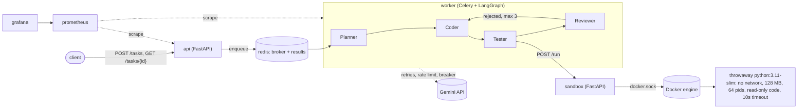
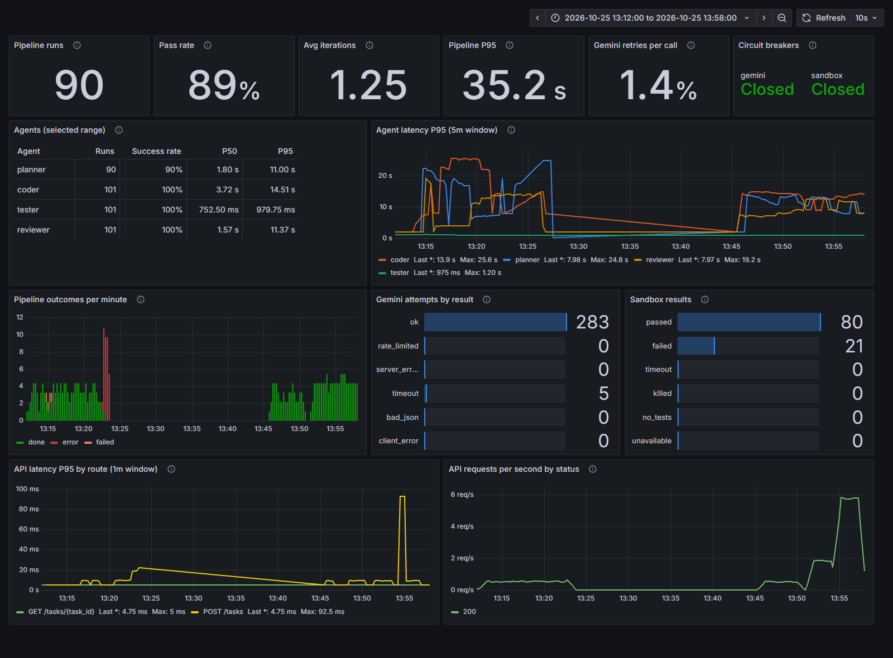

# Multi-agent coding pipeline

You send it a coding task in plain English and four agents (Planner, Coder, Tester, Reviewer)
write the code, test it in a locked-down Docker container and review it, looping back to the
Coder up to three times if the review fails. I built it to learn how to put an LLM workflow
behind real infrastructure: a task queue, retries and circuit breakers, an isolated sandbox
for untrusted code, metrics and dashboards, a load test, and a benchmark with hidden tests
so I could measure whether it actually works instead of guessing.

The agents use Gemini (`gemini-flash-lite-latest`, on the free tier) and are wired together
with LangGraph. Everything else runs in Docker Compose.

## Architecture



What happens to one task:

1. `POST /tasks` puts the task on a Redis queue and returns a task id right away.
2. A Celery worker picks it up and runs the LangGraph graph:
   - **Planner** breaks the task into subtasks.
   - **Coder** writes `solution.py` and a separate `test_solution.py` full of asserts.
   - **Tester** sends both files to the sandbox service, which runs the tests in a new container
     and returns the exit code, stdout and stderr.
   - **Reviewer** reads the task, the code, the tests and the results. It can only approve if the
     tests passed; that rule is in code, not in the prompt. If it rejects, the Coder gets the
     feedback, its previous code and the traceback, and tries again (3 iterations at most).
3. `GET /tasks/{id}` returns `queued`, `running`, then `done`, `failed` (gave up after 3
   iterations) or `error` (something crashed, like Gemini or Docker being down). Unknown ids get a 404.

## Design decisions

**The agents live in one process, not one service each.** They pass a single state object
along and call each other in order, so splitting them into networked services would only add
latency, serialization and failure modes without buying anything. They scale together as a
worker, so I scale workers instead.

**The sandbox is the one separate service, because it runs untrusted code.** It's the only
container that gets the Docker socket. The api and worker images don't even have the Docker SDK
installed, so a bug in the agent code can't start containers. The worker talks to it over HTTP
with a timeout and its own circuit breaker.

**LangGraph over CrewAI.** I wanted the control flow to be an explicit state machine I could
read and test: four nodes, one conditional edge after the reviewer, and a hard iteration cap.
CrewAI is built around agents deciding what to do next, which is the opposite of what I wanted
for a pipeline that has to be predictable and measurable.

**Three iterations at most.** Every iteration costs at least two Gemini calls and the free tier
allows 15 a minute. The eval numbers below show how much the second and third tries actually help.

**One Celery process per worker container (`--pool=solo`).** The circuit breakers, the rate
limiter and the Prometheus counters all live in process memory, so one process means each worker
has one consistent view and one `/metrics` endpoint. The default prefork pool would split that
across child processes and need Prometheus multiprocess mode. To scale I run more worker
containers (`docker compose up --scale worker=4`), and Prometheus finds all of them through
Compose's DNS.

**Hidden tests in the eval.** The Coder writes its own tests and the Reviewer is another LLM, so
"the pipeline approved it" proves very little. Every benchmark task ships a test file the
pipeline never sees, checked against a reference solution I wrote, and only those tests decide
pass or fail.

**Respecting the quota instead of retrying into it.** Calls go through a sliding-window limiter
(14 requests/min per worker by default) and a 429 is retried after the delay Google asks for.
Retries only happen for errors that can go away (429, 5xx, timeouts); a bad key or a wrong
model name fails straight away.

## Problems I hit

- **Gemini model IDs kept disappearing.** Pinned IDs started returning 404 after Google
  deprecated them. I switched to the `gemini-flash-lite-latest` alias (which currently points
  to `gemini-3.5-flash-lite`), made the model an env variable (`GEMINI_MODEL`), and kept
  `list_models.py` around to check what my key can see.
- **Windows encoding.** On Windows, `open()` without an encoding uses cp1252, so writing
  LLM-generated code that contained a non-ASCII character failed with a `UnicodeEncodeError`.
  Every file is opened with `encoding="utf-8"` now.
- **The reviewer never saw the task.** It was judging the code on its own. When I asked for
  tests asserting `add(2, 2) == 5`, the Coder quietly wrote correct tests and the Reviewer
  approved, because nothing told it what was asked. Now it gets the task description, and the
  same task ends as `failed` with the right feedback.
- **Prometheus counters missed their first event.** A labelled counter only appears when it's
  first incremented, so Prometheus never saw it at 0 and `increase()` lost that first event.
  All known label combinations are created at 0 when the process starts.
- **An infinite loop could hang the worker forever.** `containers.run(remove=True)` waits
  with no timeout. The code now runs under `timeout -k 2 10` inside the container, with a
  host-side wait as a backstop.
- **Printing forever was slow and used a lot of memory.** The old tester collected all output
  before trimming it, so a print loop took 18s instead of 10s. Running the container detached,
  with Docker's log driver capped at 1 MB, fixed that and also kept stdout when the code crashes.
- **The LLM chose file paths.** The first tester wrote the code to whatever `file_name` the
  Coder returned, so `../../evil.py` would have written outside the temp folder on my machine.
  File names are fixed now and the sandbox API rejects a `file_name` field.
- **Bind mounts stop working once the sandbox runs in a container.** The old tester mounted its
  temp folder into the code container. From inside a container that can't work: Docker resolves
  the path on the host, where the folder doesn't exist. I caught this before moving the service,
  so each run now copies the files into a fresh volume through a container that is never
  started, and mounts that volume read-only.
- **My retries were too impatient.** The free tier answered a burst with a 429 asking me to
  wait 49 seconds, while I was retrying after 2 and 4. Now the retry waits as long as it's told,
  and gives up if that's over a minute (usually the daily quota).
- **Celery says PENDING for task ids it has never seen.** So a made-up id looked like a queued
  task forever. The api records a `SENT` state when it publishes, so anything still PENDING
  really doesn't exist and gets a 404.

## Results

Every number here comes from runs I did on 2026-10-25 on my laptop (Windows 11, Docker Desktop)
with `gemini-flash-lite-latest`, which pointed to `gemini-3.5-flash-lite` that day. The raw
files are in [eval/results](eval/results) and [loadtest/results](loadtest/results).



*The dashboard over the real-Gemini part of the day: four eval runs and the real load test.
The red bars around 13:23 are the network outage in eval run 3 (below).*

### Eval: 15 tasks graded by hidden tests

5 easy, 6 medium and 4 hard tasks, standard library only. Each one has a hidden test file the
pipeline never sees, and each hidden test passes against a reference solution I wrote
(`python eval/run_eval.py --check-references` runs that check inside the sandbox).

I ran the benchmark four times. Run 3 lost its network connection halfway through (more on that
below), so these are runs 1, 2 and 4 ([eval_without_outage.md](eval/results/eval_without_outage.md)):

| | mean | range over 3 runs |
|---|---|---|
| passes the hidden tests within 3 iterations | 95.5% | 93.3% to 100% |
| passes the hidden tests on the first try | 88.9% | 86.7% to 93.3% |
| iterations used per task | 1.38 | 1.33 to 1.47 |
| wall time per task, through the api | 15.6 s | 13.9 s to 17.7 s |

Easy and medium tasks passed in every run. Hard tasks passed 3/4, 3/4 and 4/4. With run 3
included, the within-3 pass rate drops to a mean of 81.7%, ranging from 40% to 100%
([eval_all_runs.md](eval/results/eval_all_runs.md)).

What the hidden tests caught that the pipeline's own verdict didn't:

- **The Reviewer approved wrong code.** `h02_shortest_path` returned `inf` for a route made of
  zero-weight edges in runs 1 and 2. The prompt allows non-negative weights. The Coder's own
  tests passed (approval requires that), so they didn't catch it, and the Reviewer approved it
  both times. In run 4 the second attempt was correct and the Reviewer still asked for a third.
- **The Reviewer rejected correct code, a lot.** In run 4, 14 of 15 first attempts already
  passed the hidden tests, yet the pipeline still averaged 1.47 iterations, because the Reviewer
  sent correct code back on 6 of the 15 tasks. `m03_lru_cache` was correct on the first try and
  sent back anyway in three of the four runs.
- **Sometimes it rejected correct code until it gave up.** In run 1, all three attempts at
  `h04_text_justify` passed the hidden tests, the Reviewer rejected all three, and the task ended
  as `failed`.

So with this model, the extra iterations mostly pay for the Reviewer's opinion rather than fixing
bugs, and the Reviewer can't be trusted as the last word. That's exactly why the benchmark doesn't
use it.

**Run 3.** Six tasks in, the worker lost DNS (`Name or service not known` for Google's API).
After three failed attempts on one call plus two more, the Gemini circuit breaker opened. The next
task failed after 8 s (its call was the one that tripped the breaker) and the 7 after it failed
with "circuit open" before the runner's first 2-second poll, instead of each hanging through
retries. That's what the breaker is for, but it also shows a gap: a task that hits an open circuit is
failed instead of being put back on the queue for later.

### Load test

Locust users submit a task, poll every 0.5 s until it finishes, wait 1-2 s and repeat.
"Processing" is from the first `running` poll to the end, and "queue wait" is the time before that.

**Real Gemini (1 worker, rate limiter at 14 requests/min), 3 minutes per level:**

| users | tasks/min | end-to-end P50 / P95 | queue wait P50 / P95 | processing P50 / P95 | failed requests |
|---|---|---|---|---|---|
| 1 | 4.4 | 11 s / 21 s | 0.5 s / 0.5 s | 10 s / 20 s | 0 of 370 |
| 3 | 4.4 | 38 s / 47 s | 24 s / 34 s | 13 s / 19 s | 0 of 1077 |

Throughput is 4.4 tasks a minute at both levels. That's the quota: 14 calls a minute divided by
4.4 tasks is about 3.2 calls per task (one Planner call, then a Coder and a Reviewer call per
iteration). A single user already hits it, and more users only add queueing. From the start of
the eval to the end of these runs the worker made 288 successful Gemini calls and not one got a
429; the limiter made calls wait 112 times instead. With real Gemini, **the bottleneck is the free-tier quota**,
not my infrastructure.

**Infrastructure only, with the fake LLM** (`FAKE_LLM=1`: canned replies after 1.5 s, close to
the real per-agent P50s I measured under light load, 1.25 s to 1.86 s; everything else is real,
including a Docker container per test run), 4 minutes per level:

| workers | users | tasks/min | end-to-end P50 / P95 | queue wait P50 / P95 | processing P50 / P95 | POST /tasks P95 | failed requests |
|---|---|---|---|---|---|---|---|
| 1 | 1 | 8.5 | 5.6 s / 5.6 s | 0.5 s / 0.5 s | 5.1 s / 5.1 s | 12 ms | 0 of 511 |
| 1 | 5 | 11.1 | 25 s / 26 s | 20 s / 20 s | 5.1 s / 5.6 s | 130 ms | 0 of 2411 |
| 1 | 10 | 11.3 | 51 s / 52 s | 46 s / 47 s | 5.1 s / 5.6 s | 260 ms | 0 of 4778 |
| 1 | 20 | 11.3 | 103 s / 105 s | 98 s / 99 s | 5.1 s / 5.6 s | 450 ms | 0 of 9481 |
| 4 | 20 | 44.4 | 25 s / 26 s | 20 s / 21 s | 5.1 s / 5.6 s | 330 ms | 0 of 9623 |

One worker saturates at about 11.3 tasks a minute, somewhere between 1 and 5 users. After that,
processing time stays flat and only queue wait grows with the number of users, which is the
signature of a single busy server. No container was CPU-bound in the `docker stats` snapshots,
so the limit is concurrency (the solo worker runs one task at a time), not hardware. Four workers
gave 3.9 times the throughput. The first sign of the next bottleneck was the sandbox: with four
workers starting containers at once, the Tester's P95 went from 0.98 s to 1.63 s. Per-agent
P50/P95 for every level is in [loadtest/results/summary.md](loadtest/results/summary.md).

## Limitations

- **The LLM grades the LLM.** Inside the pipeline, the Coder writes the tests and a Reviewer
  LLM approves. The hidden-test eval exists because of this, and it shows how often the
  Reviewer approves wrong code.
- **The sandbox is not a hardened security boundary.** See the next section.
- **Gemini free tier.** 15 requests a minute means at most around 4 tasks a minute in total,
  whatever the infrastructure does. Google also has a daily limit; I didn't hit it, so I don't
  know its value for my key.
- **Standard library only.** The sandbox has no network and no packages, so tasks that need
  numpy or requests can't be tested.
- **The benchmark is small.** 15 tasks and a few runs give a rough number with a wide spread,
  not a precise score.
- **The infrastructure load test uses a fake LLM.** It measures the api, queue, worker and
  sandbox, not Gemini.
- **An open circuit fails the task.** When Gemini is down, tasks fail fast instead of hanging,
  but they aren't requeued for later, so a short outage costs every task submitted during it.
- **The breakers and the rate limiter are per worker.** With several workers, each one counts its
  own failures and its own requests, so `LLM_MAX_RPM` has to be divided by the number of workers
  by hand.

## The Docker socket trade-off

The sandbox service has `/var/run/docker.sock` mounted. Anything that can talk to that socket
can start a privileged container that mounts the host's filesystem, so the sandbox service is
effectively root on the host. I limited the damage where I could: only that one service has the
socket, it only exposes `POST /run` with a fixed command and fixed file names, it isn't published
outside the Compose network, and the code it runs is in a container with no network, no Linux
capabilities, `no-new-privileges`, the `nobody` user, a read-only code mount, 128 MB of memory
with no swap, 64 processes and a timeout.

That's fine for running my own benchmark on my own machine. It isn't enough for running code
from strangers, because a container shares the host kernel and one kernel bug is enough to get
out. What I'd do next, in order:

1. Run the code containers under **gVisor** (`runsc`), which puts a user-space kernel between
   the code and the real kernel. It's a runtime flag on the same Docker setup.
2. Use **rootless Docker** for the sandbox, so even a full escape lands as an unprivileged user.
3. Move execution to a **separate VM or microVM** (Firecracker) that holds nothing worth stealing,
   so the sandbox service doesn't need the host's Docker socket at all.

## Running it

You need Docker (Docker Desktop on Windows) and a Gemini API key.

```bash
cp .env.example .env      # then put your key after GEMINI_API_KEY=
make up                   # builds and starts api, worker, sandbox, redis, prometheus, grafana
```

- API: http://localhost:8000 (docs at /docs)
- Grafana dashboard: http://localhost:3000/d/pipeline (no login needed)
- Prometheus: http://localhost:9090

```bash
curl -X POST localhost:8000/tasks -H "Content-Type: application/json" \
     -d '{"task_description": "Write a function is_prime(n)"}'
curl localhost:8000/tasks/<task_id>
```

Other targets: `make test` (pytest on the host, after `pip install -r requirements-dev.txt`),
`make eval RUNS=3`, `make load-test`, `make logs`, `make down`, `make clean`.
On Windows without make, `.\tasks.ps1 up` (and the same target names) does the same thing.

## Layout

```
agents/          planner, coder, tester, reviewer, shared Gemini client (llm.py) and circuit breaker
sandbox/         the code execution service (FastAPI + Docker SDK)
graph.py         the LangGraph state machine
main.py          the api
pipeline_task.py the Celery task and the worker's /metrics server
metrics.py       every Prometheus metric
monitoring/      prometheus config and the provisioned Grafana dashboard
eval/            15 benchmark tasks with hidden tests and reference solutions, and the runner
loadtest/        locust scenario, the level runner and the raw results
tests/           pytest
```
